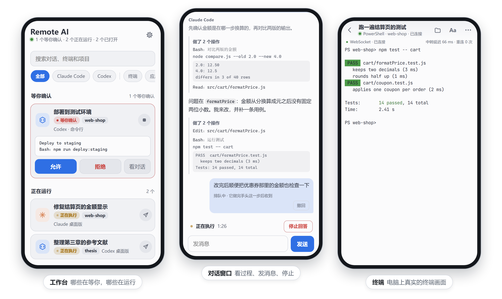
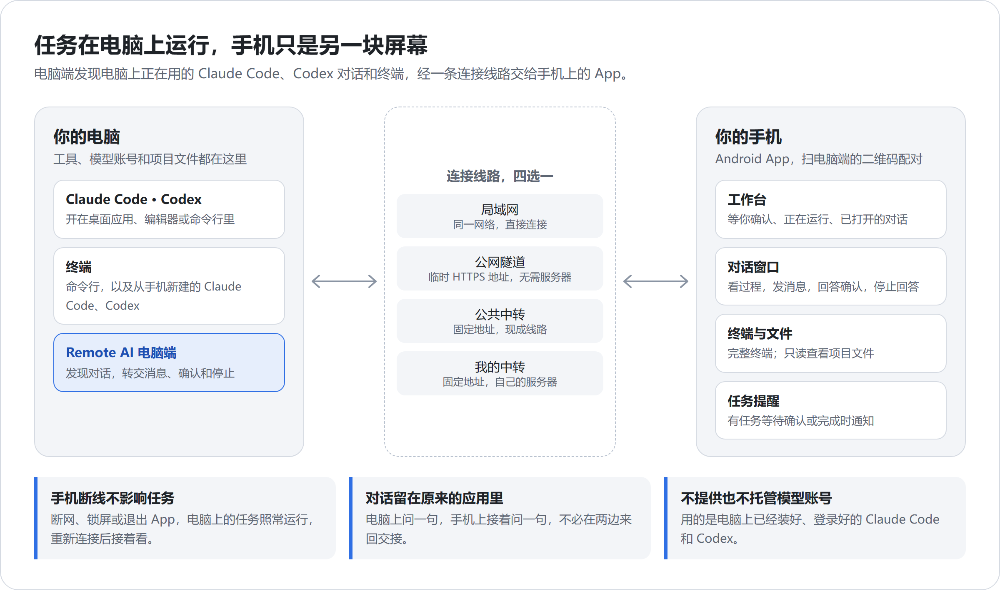
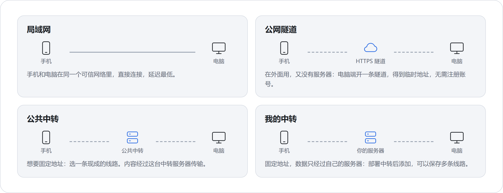
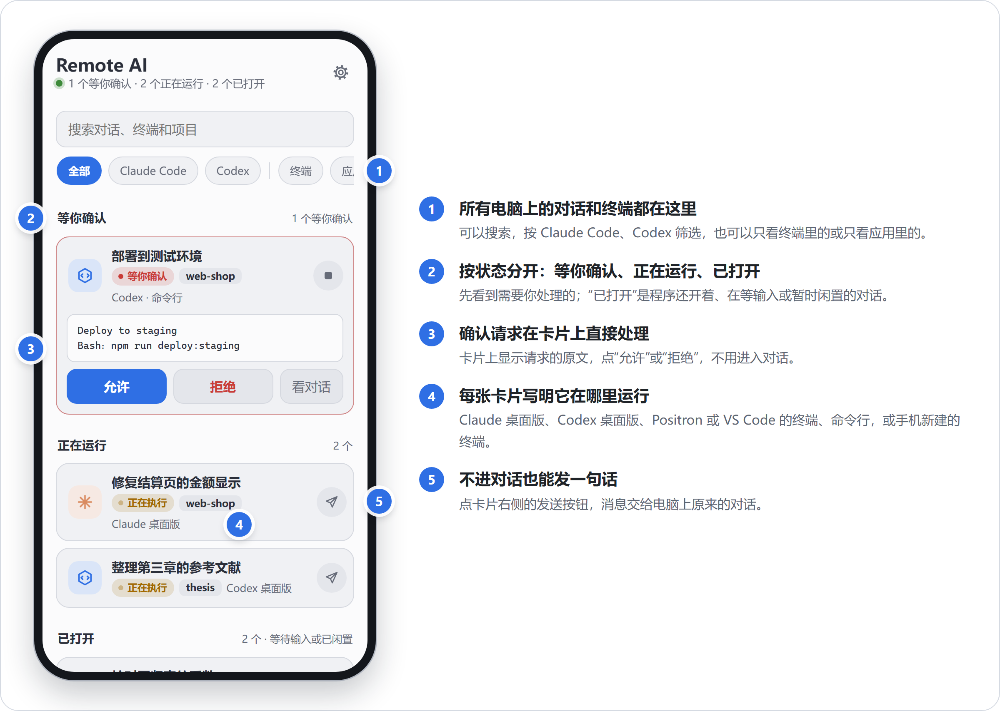
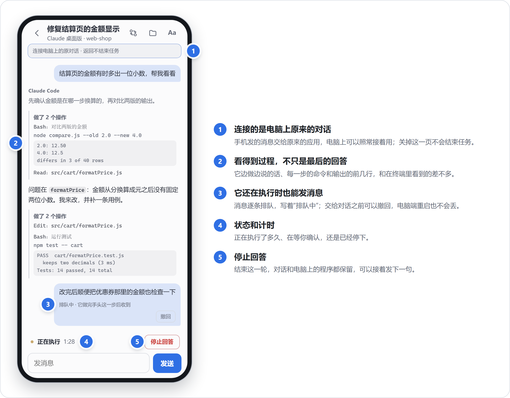
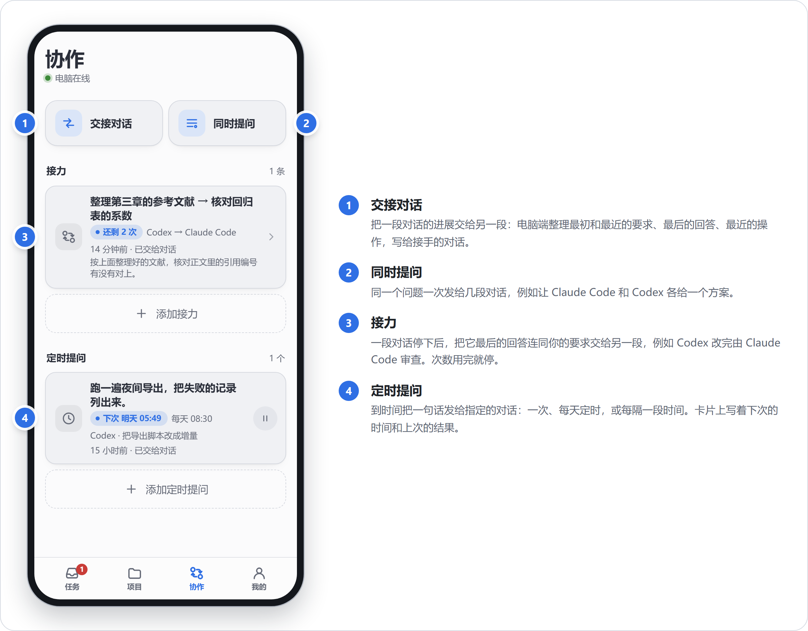
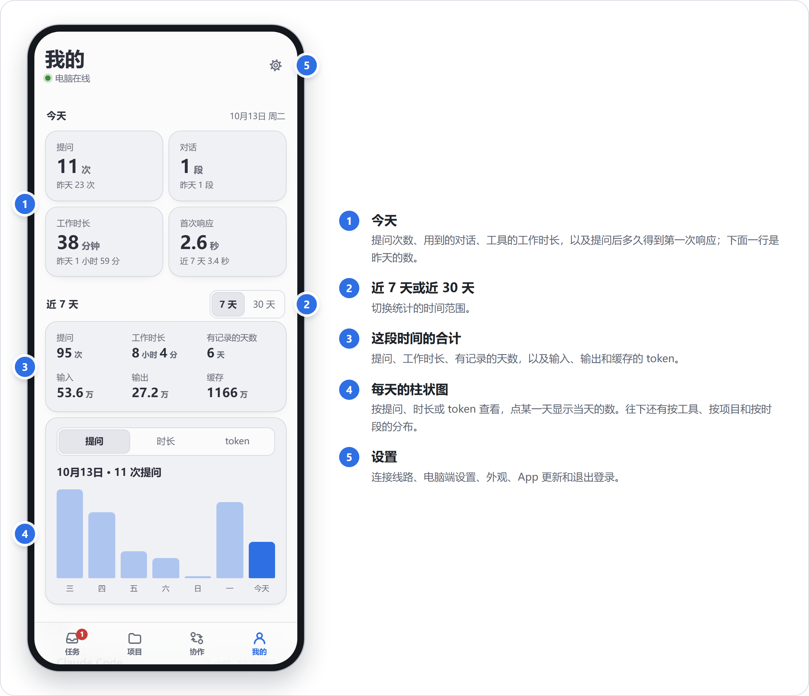
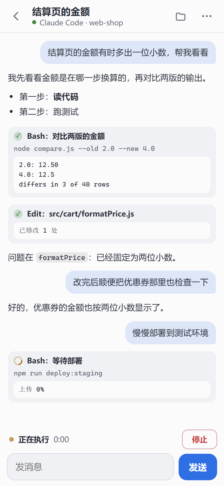

# Remote AI

**在手机上接着用电脑里的 Claude Code、Codex 和终端**

电脑上问一句，手机上接着问一句，对话仍在原来的应用里。 
离开电脑后，查看进度、发消息、回答确认请求、停止回答，或者打开完整终端继续工作。

[下载](https://github.com/KangWang42/remote-ai/releases/latest) · [三步开始](#三步开始) · [能做什么](#能做什么) · [使用说明](docs/GUIDE.md) · [常见问题](docs/FAQ.md)

## 什么时候用得上

- **任务跑到一半要离开电脑。** 在手机上看它做到了哪一步；它申请权限时，在手机上点“允许”或“拒绝”。
- **想到一句要补充的话。** 直接发给电脑上原来的对话，不用等回到电脑前，也不用另开一段对话重讲一遍。
- **发现它走偏了。** 在手机上让它停下，对话和电脑上的程序都保留，接着告诉它该怎么改。
- **需要亲手敲命令。** 打开完整终端，看到的就是电脑上真实的终端画面，手机和电脑可以共用。

Remote AI 由电脑端程序和 Android App 组成，不提供模型服务，也不托管模型账号：用的是电脑上的 Claude Code 和 Codex。电脑端首次启动时会建议安装缺少的终端工具，接受后从官方来源下载安装；也可跳过，以后在“设置 → 安装终端工具”中安装。工具安装后需自行登录相应账号。

App 底部有任务、项目、协作、我的四个栏目，都汇总所有电脑：任务页列出各台电脑上要处理的对话和终端，项目页按电脑列出项目，协作页汇总各电脑的接力和定时提问，“我的”提供统计汇总，以及分组的外观、提醒权限、更新和连接设置。进入某台电脑的页面后，底部仍是这四个栏目。电脑活动列表包含闲置但仍打开的对话，不要求先将其文件夹加入手机项目。

## 怎样工作

## 三步开始

在 [最新 Release](https://github.com/KangWang42/remote-ai/releases/latest) 下载两个安装包：

| 设备 | 文件 | 要求 |
| --- | --- | --- |
| Windows 电脑 | `RemoteCli-Setup-x.y.z.exe` | Windows 10 / 11，64 位；安装到当前用户目录，无需管理员权限 |
| Android 手机 | `RemoteCli-Android.apk` | Android 8.0 及以上 |

**1. 安装电脑端，选一种连接方式。** 打开 Remote AI，在“连接”页选择线路，等二维码出现。

**2. 手机扫码。** 打开 App，点“扫码添加电脑”，扫电脑端的二维码。工作台随即列出这台电脑上的 Claude Code、Codex 对话和终端。已经开着的对话不必先加入项目，点开就能看、能发消息。 手机保留正常长回复的完整正文；超长内容和同步中断会明确提示。Claude 执行报错会显示原因，消息需确认送达才显示已交给对话。后台提醒只在明确完成信号稳定后发送，回复中途不会误报完成。

**3. 添加项目（可选）。** 要从手机新建对话、查看项目文件，在电脑端“项目”页或手机上添加文件夹。想在离开 App 后收到提醒，在“我的 → 提醒与权限”检查通知、电池和后台联网设置，再开启“任务提醒”。

<b>四种连接方式怎么选</b>

 

| 场景 | 选择 | 说明 |
| --- | --- | --- |
| 手机和电脑在同一个可信网络 | 局域网 | 延迟最低；首次运行按提示允许 Windows 防火墙访问 |
| 在外面用，没有服务器 | 公网隧道 | 下载隧道程序后得到临时 HTTPS 地址，无需注册账号 |
| 想要固定地址 | 公共中转 | 选择现成的线路；内容经该中转服务器传输 |
| 想用自己的服务器 | 我的中转 | [部署中转](docs/SELF_HOSTING.md)后添加，可保存多条线路 |

<b>安装时的系统提示、更新和 Linux</b>

 

- Windows 安装包尚无发布者代码签名，系统可能提示“未知发布者”。Android APK 使用固定密钥签名以支持覆盖更新，首次安装需允许对应来源安装应用。
- 手机更新：进入 App“我的 → 手机 App 更新”。电脑更新：进入“我的 → 已连接的电脑 → 管理”，查看电脑当前版本和在线状态，点击“检查并更新电脑端”；发现新版后由电脑下载、安装并重启。电脑端“设置”也可更新。1.5.7 及更早版本需手动安装一次 1.5.8 或更高版本，之后可以在应用内更新。
- 项目原名 Remote CLI，安装包和命令仍沿用 `RemoteCli`、`remote-cli`。
- Linux 提供后台电脑端，支持远程终端和文件查看，安装方法和差异见 [Linux 说明](docs/LINUX.md)。
- Linux Python 电脑端新增 OpenCode、Qoder、Cline 的终端和历史对话支持；手机可查看、继续对话及安排定时提问。Windows 电脑端仍支持 Claude Code、Codex 和 PowerShell。

## 能做什么

### 工作台：先看到需要你的

多台电脑各扫码一次，“任务”集中显示它们的待处理任务，“项目”按电脑列出在线状态和项目。App 和每台电脑的页面底部是同样的四个栏目：任务、项目、协作、我的。

### 对话窗口：接着电脑上的那段对话

两个工具在手机上是同一个窗口、同一组操作。电脑端为每个操作选用当时可用的方式；某个操作做不了时，窗口直接写出原因。

| | Claude Code 命令行、编辑器终端、Claude 桌面应用里的 Code 对话 | Codex 桌面应用 | Codex CLI 命令行、编辑器终端 |
| --- | --- | --- | --- |
| **执行中发消息** | 做完手头这一步后收到 | 并入正在运行的这一轮；应用等待确认时排队 | 这一轮结束时收到 |
| **空闲时发消息** | 唤醒原对话，十几秒到半分钟 | 立即开始下一轮 | 经 Codex 的队列送达 |
| **回答确认请求** | 电脑或手机，谁先回答都可以 | 电脑无人操作满一分钟后交给手机 | 电脑无人操作满一分钟后交给手机 |
| **停止回答** | 结束正在跑的命令，并在下一步之前停下 | 立即停止这一轮；目标任务除外 | 不能单独停止；能确认进程时可以结束它 |

排队的消息保存在电脑端，逐条显示，交给对话之前可以撤回；按了“停止回答”后，还没交出去的消息会暂停，由你决定继续发送还是撤回。

手机保存 Claude Code 授权前会检查规则，并显示适用范围。可能引发启动警告的通配符规则只提供单次允许，不会保存为长期授权。

确认按钮标明“允许一次”。Claude Code 为请求提供可保存的规则时，还可查看完整规则并选择“始终允许此规则”；Codex 钩子仅支持单次授权，其他范围在原应用里选择。终端卡片点“选择授权范围”进入真实终端。手机处理后电脑显示结果提示，电脑处理后手机自动更新请求状态。

### 协作：让几段对话配合

这四件事由电脑端执行，手机离开后照常进行。接手或被提问的对话可以是电脑上的程序打开着的，也可以是手机终端里正在运行的；Claude Code 和 Codex 的对话可以互相交接、接力。

协作页顶部集中提供“添加接力、定时提问、交接对话、同时提问”。只有一台电脑时直接进入表单，多台时先选电脑。下方按电脑显示已有安排，点一条即可编辑，并查看剩余次数、下次执行时间和最近结果。接力可快速填入审查改动、补充测试或整理文档的要求；同时提问会逐段显示发送结果，部分失败时保留详情。

### 我的：统计与设置

“我的”把设置按连接与提醒、外观与体验、应用信息分组；提醒页会直接打开 Android 对应系统设置，并显示当前通知权限。统计由电脑端从 Claude Code 和 Codex 自己的记录里读出，只取数字、日期和文件夹名称，不读取也不传送对话内容。

“已连接的电脑”中，每台电脑的“管理”提供版本、远程更新、工作台、电脑设置和连接管理。电脑离线时会保留本次已读取的版本，并标明“上次读取”。更新可能打断正在执行的终端任务，建议先等任务完成；页面只在读取到电脑在线且版本升高后确认更新完成。仅收到请求或暂时断线不会显示为安装成功。

开启任务提醒后，App 保留一条后台连接通知，约每 10 秒查看电脑状态；点击任务通知进入对应对话。可在“提醒与权限”检查通知、电池优化和后台联网，发送测试通知。深度省电、断网或强行停止应用可能延迟提醒。

### 终端与新对话

<table>
<tr>
<td width="50%" valign="top" align="center"></td>
<td width="50%" valign="top" align="center"></td>
</tr>
<tr>
<td valign="top"><b>完整终端。</b> 从手机新建的 Claude Code、Codex 或命令行终端，显示的是电脑上真实的终端画面，可以输入命令，发送 Esc、Tab、Ctrl+C 等按键，回看输出。同一个终端也能在电脑上打开，两端共用画面和输入。</td>
<td valign="top"><b>手机上的对话。</b> 在项目页或“任务”右上角的 + 新建，选“应用”就由电脑直接运行 Claude Code 或 Codex，手机上是一段对话：回答边写边显示，每一步的命令和输出实时出现，确认、停止、随时补充一句都在这一页完成，电脑前不需要有人。选“终端”则是完整终端，选择会保留。</td>
</tr>
</table>

对电脑上独立启动的 CLI，能确认所属进程且可以安全结束时，提供“接管到手机终端”：原 CLI 结束，同一段历史在手机终端里继续。

### 其它

| 能力 | 说明 |
| --- | --- |
| 项目文件 | 查看代码、Markdown、笔记本、表格、PDF、图片、Word 和 PowerPoint，下载到手机，也可向电脑上传手机本地文件 |
| 任务提醒 | 有任务等待确认或完成时通知；需手动开启，受 Android 后台限制影响 |
| 远程设置 | 从手机切换连接线路、调整电脑端设置、发起更新；线路切换失败时恢复原线路 |
| 远程桌面 | 在“我的 → 已连接的电脑 → 管理 → 远程桌面”关联 UU 远程，按需打开 Windows/Mac 桌面或小窗；需要手机 UU 4.42.0 及以上 |
| 外观 | 六套配色，字体、字号和行距可调；终端提供触屏按键，支持系统语音输入 |

## 使用限制

- **支持的是 Claude Code 对话**，包括 Claude 桌面应用里的 Code 对话，不包含普通 Claude 聊天。安装钩子之前就已打开的对话，需要在电脑上重新打开一次。
- **Codex 桌面应用的原对话控制目前适配 Windows 上的 `26.1007.2314.0`**，并要求应用已载入目标对话；其它版本不启用这条通道。在桌面应用里打开新对话需要 Codex `26.1007.2314.0` 或 Claude `2.31226.1.0` 及以上。
- **能做什么随工具的状态变化。** 应用版本、连接、钩子和进程归属都会影响可用操作；做不了时窗口会显示原因。
- **对话窗口不是终端。** 电脑上打开着的对话显示近期消息和每一步的摘要，按记录刷新；手机上的对话边写边显示，但都不能输入斜杠命令或逐键控制，需要时用终端。
- **手机上的对话需要 1.7.0 及以上的电脑端**（Linux 电脑端 0.7.0 及以上），支持 Claude Code 和 Codex。它开着的时候不要在电脑上同时打开同一段对话。
- **提醒不是服务器推送。** App 约每 10 秒检查一次，深度休眠或后台限制可能推迟通知。最多同时运行 8 个终端。
- **文件传输。** Windows 电脑端和 Linux 电脑端（Python 版）支持向当前项目文件夹上传手机本地文件，可多选；上传、下载单个文件上限 300 MB。同名文件不覆盖，不支持在线编辑或删除。
- **协作和统计由电脑端完成**，需要 1.6.0 及以上的电脑端。Windows 电脑端的接力依赖 Claude Code 和 Codex 的钩子；Linux 电脑端根据来源对话的记录判断一轮结束（记录增长后静止 45 秒），会晚一些转交。Linux 电脑端的接力、交接和定时提问只能发给手机终端里的对话。
- 暂无 iOS App 和 macOS 电脑端；界面目前为中文。
- UU 桌面入口使用独立的 UU 客户端和账号，不要求 Remote AI 电脑端在线。全屏连接结果在 UU 中查看，小窗回执只确认启动结果；不提供持续连接监测。此入口不支持 Linux 或手机作为被控端。关联只保存在当前手机，移除关联不会撤销 UU 中的设备授权。

各项行为的细节和等待时限见[使用说明](docs/GUIDE.md)。

## 连接与数据安全

连接地址和密码具有远程操作这台电脑的权限，请妥善保管。

- **任务和数据留在电脑上。** 项目不设账号体系，不收集使用统计。对话窗口和文件内容由电脑读取后转发，中转不持久保存；中转只保留终端最近的画面用于重连恢复。
- **公共中转的运营者在技术上能够看到经过服务器的内容。** 敏感任务请使用可信局域网或自己的中转。局域网 HTTP 只用于可信网络，外网使用 HTTPS 隧道或中转。
- **项目列表不是安全沙箱。** 手机只能在已添加的项目里新建对话和终端，但终端拥有当前电脑用户的权限。文件查看限定在项目目录内。
- **可以随时关掉。** 关闭“允许手机访问”立即阻止远程访问；关闭“手机处理电脑上的对话”会移除电脑端写入 Claude Code、Codex 设置里的钩子条目（只改本程序的条目，并保留备份）。
- Windows 电脑端用 DPAPI 加密保存密码，手机登录有失败次数限制；内置下载的隧道程序使用固定版本并校验完整性。

安全问题可通过 GitHub 私密漏洞报告提交。

## 常见问题

<b>手机断网、锁屏或退出 App，任务会停吗？</b>

 
不会。任务在电脑上运行，重新连接后可以接着查看和操作。

<b>需要把 Claude 或 OpenAI 的账号交给它吗？</b>

 
不需要。Remote AI 使用电脑上已经安装并登录的 Claude Code 和 Codex，以及电脑本地的文件和配置。

<b>为什么有的对话不能发消息，或者没有“停止回答”？</b>

 
能做什么取决于这段对话开在哪里、工具当时的状态和版本，见上面的对照表。做不了的时候，对话窗口会写出原因，例如 Codex CLI 的回答不能从外面单独停止。

<b>“停止回答”“结束”和关掉对话窗口有什么区别？</b>

 
“停止回答”只结束这一轮，对话保留；“结束”会关闭电脑上拿着这段对话的程序，记录保留；关掉手机上的对话窗口只是不再查看，电脑上的任务照常进行。

更多问题见[常见问题](docs/FAQ.md)。

## 文档与开发

| 文档 | 内容 |
| --- | --- |
| [使用说明](docs/GUIDE.md) | 安装、工作台、对话协作、终端、文件、更新和卸载 |
| [常见问题](docs/FAQ.md) | 连接失败、更新失败、确认和对话控制问题 |
| [Linux 电脑端](docs/LINUX.md) | 安装命令、后台服务和平台差异 |
| [自己部署中转](docs/SELF_HOSTING.md) | 服务部署、HTTPS 和公共中转运营 |
| [组成、构建和测试](docs/DEVELOPMENT.md) | 项目结构、源码构建及测试入口 |
| [接口协议](docs/PROTOCOL.md) | Android、电脑端与中转之间的接口及应用适配约定 |

`agent-windows/` 是 Windows 电脑端，`android/` 是手机 App，`relay/` 负责连接和转发。`web/` 是 App 使用、随电脑端分发的内嵌页面和终端组件。Linux 与 Rust 电脑端位于各自目录。

## 许可

[MIT](LICENSE)。第三方组件见 [THIRD_PARTY.md](THIRD_PARTY.md)。Claude Code 和 Codex 分别是 Anthropic 和 OpenAI 的产品，Remote AI 是独立项目，使用电脑上已安装的相应程序。
