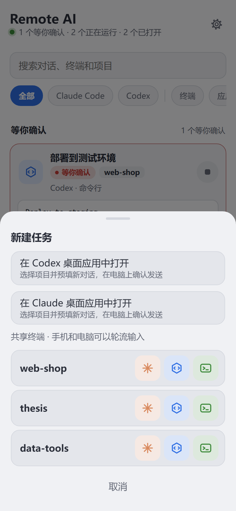

# Remote AI

**在手机上接着用电脑里的 Claude Code、Codex 和终端**

电脑上问一句，手机上接着问一句，对话仍在原来的应用里。 
离开电脑后，查看进度、发消息、回答确认请求、停止回答，或者打开完整终端继续工作。

[下载](https://github.com/KangWang42/remote-ai/releases/latest) · [三步开始](#三步开始) · [能做什么](#能做什么) · [使用说明](docs/GUIDE.md) · [常见问题](docs/FAQ.md)

## 什么时候用得上

- **任务跑到一半要离开电脑。** 在手机上看它做到了哪一步；它申请权限时，在手机上点“允许”或“拒绝”。
- **想到一句要补充的话。** 直接发给电脑上原来的对话，不用等回到电脑前，也不用另开一段对话重讲一遍。
- **发现它走偏了。** 在手机上让它停下，对话和电脑上的程序都保留，接着告诉它该怎么改。
- **需要亲手敲命令。** 打开完整终端，看到的就是电脑上真实的终端画面，手机和电脑可以共用。

Remote AI 由电脑端程序和 Android App 组成，不提供模型服务，也不托管模型账号：用的是电脑上已经装好、登录好的 Claude Code 和 Codex。

## 怎样工作

## 三步开始

在 [最新 Release](https://github.com/KangWang42/remote-ai/releases/latest) 下载两个安装包：

| 设备 | 文件 | 要求 |
| --- | --- | --- |
| Windows 电脑 | `RemoteCli-Setup-x.y.z.exe` | Windows 10 / 11，64 位；安装到当前用户目录，无需管理员权限 |
| Android 手机 | `RemoteCli-Android.apk` | Android 8.0 及以上 |

**1. 安装电脑端，选一种连接方式。** 打开 Remote AI，在“连接”页选择线路，等二维码出现。

**2. 手机扫码。** 打开 App，点“扫码添加电脑”，扫电脑端的二维码。工作台随即列出这台电脑上的 Claude Code、Codex 对话和终端。已经开着的对话不必先加入项目，点开就能看、能发消息。

**3. 添加项目（可选）。** 要从手机新建任务、查看项目文件，在电脑端“项目”页或手机上添加文件夹。想在离开 App 后收到提醒，在工作台开启“任务提醒”。

<b>四种连接方式怎么选</b>

 

| 场景 | 选择 | 说明 |
| --- | --- | --- |
| 手机和电脑在同一个可信网络 | 局域网 | 延迟最低；首次运行按提示允许 Windows 防火墙访问 |
| 在外面用，没有服务器 | 公网隧道 | 下载隧道程序后得到临时 HTTPS 地址，无需注册账号 |
| 想要固定地址 | 公共中转 | 选择现成的线路；内容经该中转服务器传输 |
| 想用自己的服务器 | 我的中转 | [部署中转](docs/SELF_HOSTING.md)后添加，可保存多条线路 |

<b>安装时的系统提示、更新和 Linux</b>

 

- Windows 安装包尚无发布者代码签名，系统可能提示“未知发布者”。Android APK 使用固定密钥签名以支持覆盖更新，首次安装需允许对应来源安装应用。
- 已安装的用户在电脑端“设置”和 App 的“检查更新”里更新，建议两端都更新。1.5.7 及更早版本需手动安装一次 1.5.8 或更高版本，之后可以在应用内更新。
- 项目原名 Remote CLI，安装包和命令仍沿用 `RemoteCli`、`remote-cli`。
- Linux 提供后台电脑端，支持远程终端和文件查看，安装方法和差异见 [Linux 说明](docs/LINUX.md)。

## 能做什么

### 工作台：先看到需要你的

多台电脑各扫码一次，工作台集中显示它们的在线状态和待处理任务。

### 对话窗口：接着电脑上的那段对话

两个工具在手机上是同一个窗口、同一组操作。电脑端为每个操作选用当时可用的方式；某个操作做不了时，窗口直接写出原因。

| | Claude Code 命令行、编辑器终端、Claude 桌面应用里的 Code 对话 | Codex 桌面应用 | Codex CLI 命令行、编辑器终端 |
| --- | --- | --- | --- |
| **执行中发消息** | 做完手头这一步后收到 | 并入正在运行的这一轮；应用等待确认时排队 | 这一轮结束时收到 |
| **空闲时发消息** | 唤醒原对话，十几秒到半分钟 | 立即开始下一轮 | 经 Codex 的队列送达 |
| **回答确认请求** | 电脑或手机，谁先回答都可以 | 电脑无人操作满一分钟后交给手机 | 电脑无人操作满一分钟后交给手机 |
| **停止回答** | 结束正在跑的命令，并在下一步之前停下 | 立即停止这一轮；目标任务除外 | 不能单独停止；能确认进程时可以结束它 |

排队的消息保存在电脑端，逐条显示，交给对话之前可以撤回；按了“停止回答”后，还没交出去的消息会暂停，由你决定继续发送还是撤回。

### 终端与新任务

<table>
<tr>
<td width="50%" valign="top" align="center"></td>
<td width="50%" valign="top" align="center"></td>
</tr>
<tr>
<td valign="top"><b>完整终端。</b> 从手机新建的 Claude Code、Codex 或命令行终端，显示的是电脑上真实的终端画面，可以输入命令，发送 Esc、Tab、Ctrl+C 等按键，回看输出。同一个终端也能在电脑上打开，两端共用画面和输入。</td>
<td valign="top"><b>新建任务。</b> 可以直接新建终端，完全在手机上推进；也可以让电脑上的 Codex 或 Claude 桌面应用打开项目并预填草稿，草稿在电脑上确认发送后，手机上出现“进入这段对话”。</td>
</tr>
</table>

对电脑上独立启动的 CLI，能确认所属进程且可以安全结束时，提供“接管到手机终端”：原 CLI 结束，同一段历史在手机终端里继续。

### 其它

| 能力 | 说明 |
| --- | --- |
| 项目文件 | 只读查看代码、Markdown、笔记本、表格、PDF、图片、Word 和 PowerPoint，可保存到手机 |
| 任务提醒 | 有任务等待确认或完成时通知；需手动开启，受 Android 后台限制影响 |
| 远程设置 | 从手机切换连接线路、调整电脑端设置、发起更新；线路切换失败时恢复原线路 |
| 外观 | 六套配色，字体、字号和行距可调；终端提供触屏按键，支持系统语音输入 |

## 使用限制

- **支持的是 Claude Code 对话**，包括 Claude 桌面应用里的 Code 对话，不包含普通 Claude 聊天。安装钩子之前就已打开的对话，需要在电脑上重新打开一次。
- **Codex 桌面应用的原对话控制目前适配 Windows 上的 `26.1007.2314.0`**，并要求应用已载入目标对话；其它版本不启用这条通道。在桌面应用里打开新对话需要 Codex `26.1007.2314.0` 或 Claude `2.31226.1.0` 及以上。
- **能做什么随工具的状态变化。** 应用版本、连接、钩子和进程归属都会影响可用操作；做不了时窗口会显示原因。
- **对话窗口不是终端。** 它显示近期消息和每一步的摘要，不能逐键控制；要完整输入，用终端。
- **提醒不是即时推送。** App 约每分钟检查一次，深度休眠或后台限制可能推迟通知。最多同时运行 8 个终端。
- **文件只读。** 不支持编辑、上传或删除。
- 暂无 iOS App 和 macOS 电脑端；界面目前为中文。

各项行为的细节和等待时限见[使用说明](docs/GUIDE.md)。

## 连接与数据安全

连接地址和密码具有远程操作这台电脑的权限，请妥善保管。

- **任务和数据留在电脑上。** 项目不设账号体系，不收集使用统计。对话窗口和文件内容由电脑读取后转发，中转不持久保存；中转只保留终端最近的画面用于重连恢复。
- **公共中转的运营者在技术上能够看到经过服务器的内容。** 敏感任务请使用可信局域网或自己的中转。局域网 HTTP 只用于可信网络，外网使用 HTTPS 隧道或中转。
- **项目列表不是安全沙箱。** 手机只能在已添加的项目里新建终端，但终端拥有当前电脑用户的权限。文件查看限定在项目目录内。
- **可以随时关掉。** 关闭“允许手机访问”立即阻止远程访问；关闭“手机处理电脑上的对话”会移除电脑端写入 Claude Code、Codex 设置里的钩子条目（只改本程序的条目，并保留备份）。
- Windows 电脑端用 DPAPI 加密保存密码，手机登录有失败次数限制；内置下载的隧道程序使用固定版本并校验完整性。

安全问题可通过 GitHub 私密漏洞报告提交。

## 常见问题

<b>手机断网、锁屏或退出 App，任务会停吗？</b>

 
不会。任务在电脑上运行，重新连接后可以接着查看和操作。

<b>需要把 Claude 或 OpenAI 的账号交给它吗？</b>

 
不需要。Remote AI 使用电脑上已经安装并登录的 Claude Code 和 Codex，以及电脑本地的文件和配置。

<b>为什么有的对话不能发消息，或者没有“停止回答”？</b>

 
能做什么取决于这段对话开在哪里、工具当时的状态和版本，见上面的对照表。做不了的时候，对话窗口会写出原因，例如 Codex CLI 的回答不能从外面单独停止。

<b>“停止回答”“结束”和关掉对话窗口有什么区别？</b>

 
“停止回答”只结束这一轮，对话保留；“结束”会关闭电脑上拿着这段对话的程序，记录保留；关掉手机上的对话窗口只是不再查看，电脑上的任务照常进行。

更多问题见[常见问题](docs/FAQ.md)。

## 文档与开发

| 文档 | 内容 |
| --- | --- |
| [使用说明](docs/GUIDE.md) | 安装、工作台、对话协作、终端、文件、更新和卸载 |
| [常见问题](docs/FAQ.md) | 连接失败、更新失败、确认和对话控制问题 |
| [Linux 电脑端](docs/LINUX.md) | 安装命令、后台服务和平台差异 |
| [自己部署中转](docs/SELF_HOSTING.md) | 服务部署、HTTPS 和公共中转运营 |
| [组成、构建和测试](docs/DEVELOPMENT.md) | 项目结构、源码构建及测试入口 |
| [接口协议](docs/PROTOCOL.md) | Android、电脑端与中转之间的接口及应用适配约定 |

`agent-windows/` 是 Windows 电脑端，`android/` 是手机 App，`relay/` 负责连接和转发。`web/` 是 App 使用、随电脑端分发的内嵌页面和终端组件。Linux 与 Rust 电脑端位于各自目录。

## 许可

[MIT](LICENSE)。第三方组件见 [THIRD_PARTY.md](THIRD_PARTY.md)。Claude Code 和 Codex 分别是 Anthropic 和 OpenAI 的产品，Remote AI 是独立项目，使用电脑上已安装的相应程序。
