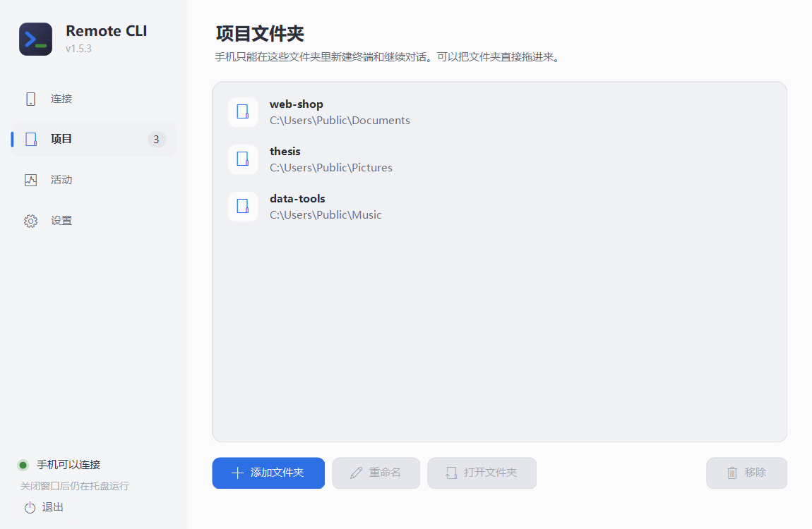
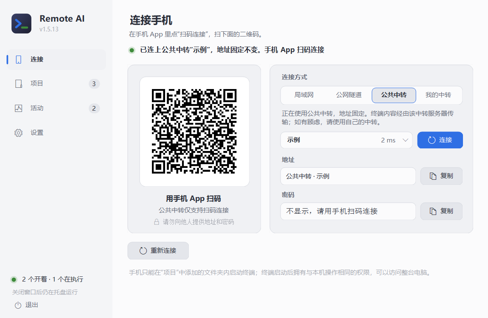
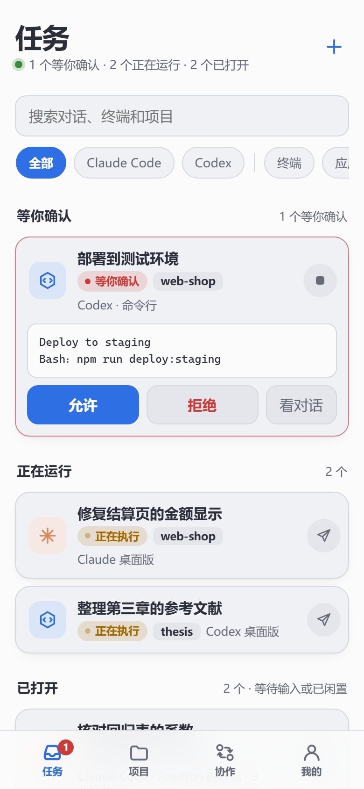
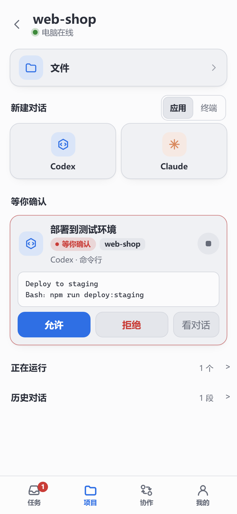
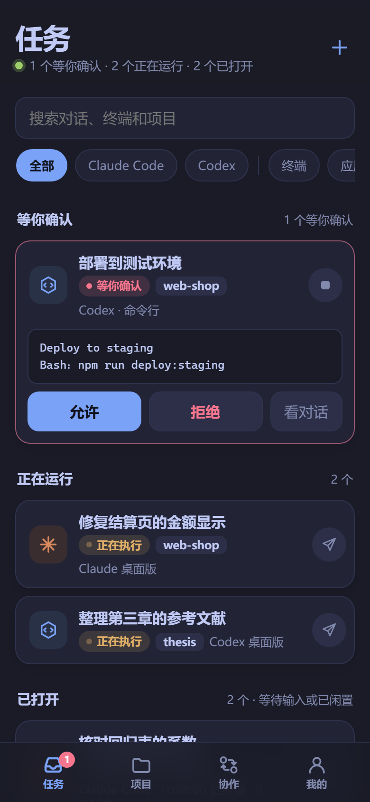
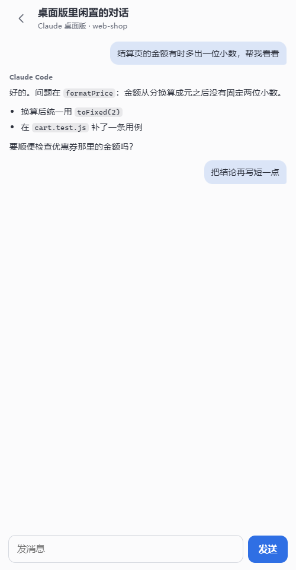
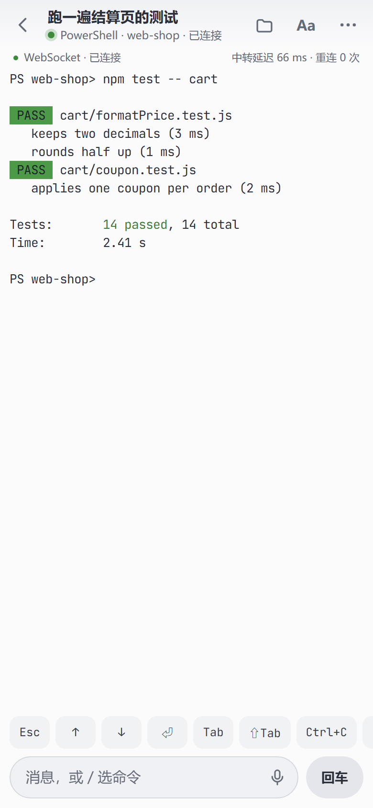
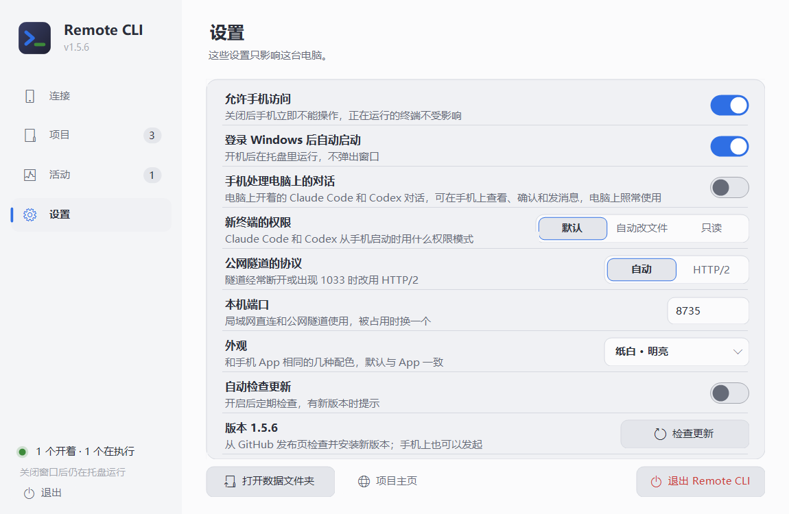

# 使用说明

[← 回到首页](../README.md)

从安装到日常使用的完整说明。只想尽快用上，看首页的“快速开始”就够了。

## 安装与连接

### 第 1 步：电脑上安装并打开

运行 `RemoteCli-Setup-x.y.z.exe`。安装位置可以改，点“浏览…”选别的盘或文件夹；选了已有内容的文件夹时，程序会装进里面新建的 `RemoteCli` 文件夹。

装完会自动打开主窗口，桌面和开始菜单里也会有 Remote CLI 的图标。以后想换位置，再运行一次安装程序选新位置即可，设置和密码会保留。

### 第 2 步：添加项目文件夹

第一次打开会停在“项目”页。点“添加文件夹”选你平时写代码的文件夹，或者把文件夹直接拖进窗口；可以加多个，也可以改名、移除。手机只能在这里列出的文件夹里开终端。

### 第 3 步：选连接方式

| 方式 | 什么时候用 | 要做什么 |
| --- | --- | --- |
| 局域网直连 | 手机和电脑连着同一个 Wi-Fi | 直接选它。第一次会弹出 Windows 防火墙询问，选“允许”。最快 |
| 公网隧道 | 人在外面，手头没有服务器 | 点“下载隧道程序”，确认后程序从 Cloudflare 的 GitHub 发布页下载 `cloudflared`（约 60 MB，只需一次），几秒后得到一个 https 地址。不需要注册账号 |
| 公共中转 | 想要固定地址，手头没有服务器 | 点“公共中转”，在选择框里挑一条线路，点“连接”。不用任何配置 |
| 我的中转 | 想要固定地址，并自己掌握服务器 | 点“我的中转”，在选择框里选一个，或“添加自己的中转…”，填自己服务器上中转的地址和密码。服务器上怎么装见 [自己部署中转](SELF_HOSTING.md) |

在“连接”页上方选方式。状态一行变成绿色、左边出现二维码，就可以用手机连了。

连接方式可以随时换。换的时候正在运行的终端不会结束，手机重新扫码后看到的还是同一批终端。两种中转都是先检查、通过才切换，没通过时原来的连接不受影响。“重新连接”按当前选中的方式重连：选中一种中转而它还没在用时，点“重新连接”和点“连接”一样，检查通过就切换到选择框里的那一个。

**两种中转。** 各占一个页签，选择框里是当前选中的那一个和它的延迟，点开列出这一种的全部线路。线路再多，也只是列表变长：

- **公共中转**：由项目提供的清单给出，不用任何配置。点一条线路，电脑端自动在那台中转上申请一个只属于这台电脑的空间，地址固定；别的电脑看不到你的终端。公共中转的地址和密码不在窗口里显示，手机扫码即可。清单会自动更新，线路可能增加、更换或撤掉；清单为空时这个页签里没有可选的线路。使用公共中转时，终端的输入和输出会经过中转服务器，它的运营者在技术上能够看到；处理敏感内容时请用局域网直连、公网隧道或自己的中转。
- **我的中转**：你添加过的自己服务器上的中转，地址和密码记在这台电脑上（用 Windows 账户加密保存）。点一个就切换过去，不用再填。选择框里还有下面两项。
- **添加自己的中转…**：填地址、密码和一个可选的名称。程序先检查，能连上才保存并切换；没通过时原来的连接不受影响，并说明是地址、证书还是密码的问题。
- **移除我的中转**：不再记着某个中转；正在使用的那个要先换到别的方式。

每一项右边是这台电脑到它的延迟，连不上的会标出来，方便挑一个快的。

更新程序时隧道保持运行，地址不变，手机不用重新扫码；退出程序或重启电脑后地址会变，重新扫码即可。Cloudflare 不对这种临时隧道的可用性做保证，也需要你的网络能访问 GitHub 和 Cloudflare。隧道经常断开或手机上出现 1033 错误时，到“设置”把“公网隧道的协议”改为 HTTP/2。

### 第 4 步：手机上安装 App 并扫码

1. 在手机上安装 `RemoteCli-Android.apk` 并打开。
2. 点“扫码添加电脑”，第一次会询问相机权限，允许后对准电脑窗口里的二维码，识别到就自动连上。
3. 不想给相机权限或扫不了时，点“手动输入地址”，把电脑窗口里的“地址”和“密码”填进去。用手机系统相机扫那个二维码也可以，会跳回 App。

相机相机画面仅用于在本机识别二维码，不保存，不上传。连上一次后 App 会记住这台电脑，90 天内不用再输密码。

## 手机上怎么用

App 有三层：**工作台**（所有电脑）→ **一台电脑**（它的项目和任务）→ **终端**。常用的路径是打开 App、在工作台点一个任务、直接进终端。

### 工作台：所有电脑上要处理的事

只连了一台电脑时，打开 App 直接进入这台电脑；连了两台或更多时，打开 App 先看到工作台。在一台电脑的首页点左上角的“‹”，或按系统返回键，都能回到工作台。

工作台把所有电脑上的终端和对话放在一起，按“要不要你管”分成几段，同一个终端或同一段对话只出现在一段里：

- **等你处理。** 等你确认的排在最前，其次是已经做完、等你看结果或等你下一条消息的。
- **置顶。** 你置顶过的对话和终端，开着的在前。
- **进行中。** 其余开着的：正在执行的、等待输入的、电脑上自己开着的 Claude Code 和 Codex 对话。最多列 12 个，其余的在各自的项目里。
- **最近。** 所有项目里最近用过的对话和最近结束的终端，按时间排列，先显示 5 个，点“其余 N 个”显示更多。点一段对话直接继续它；点一个已结束的终端查看最后的画面。同一段对话只列一次：它正在终端里运行时不列在这里，结束后在这里列的是可以继续的那段对话。

每张卡片写法相同：状态、它在哪里运行（手机终端、命令行、Codex 桌面版、编辑器等）、所属项目，连了多台电脑时再加电脑名。点手机终端直接进入，这时终端页左上角的“‹”回到工作台；点电脑上打开着的对话会先给你看它最近的内容，不用先进那台电脑。

- **搜索。** 最上面的搜索框查找所有电脑上的对话和终端，按名称、项目、工具、运行位置或电脑名都能找到，多个词用空格隔开；隐藏的对话也能搜到。
- **筛选。** 搜索框下面一行可以只看某个工具（Claude Code、Codex、终端），或只看某一种运行位置（手机终端、命令行、应用）。两组可以同时选，点“全部”清除。只有一种时不显示这一行。
- **长按卡片。** 置顶或取消置顶；把一段历史对话从列表隐藏或恢复；结束一个手机终端。置顶和隐藏记在电脑上，换手机、换连接线路后仍然有效；电脑端版本较早时没有这两项。
- **未加入项目的对话。** 电脑上开着、但所在文件夹不是项目的 Claude Code 或 Codex 对话也列出来，卡片上写着文件夹名和“未加入项目”。点开可以查看内容；它的工具能被手机处理时，也可以确认和发消息。要在手机上接着做，和项目里的对话一样直接选“在手机上继续”（Codex 还可以“另开一份继续”）：终端就开在这段对话原来的文件夹里，不需要先把文件夹加为项目，卡片和终端页上仍写着文件夹名和“未加入项目”。这样的终端没有“文件”入口。想把文件夹放进项目列表时，长按卡片选“把所在文件夹加为项目”。Linux 电脑端不能替你结束电脑上正在使用对话的程序，这类对话在 Linux 上只能查看，或加为项目后在电脑上结束再继续。
- **结束终端。** 进行中的手机终端右侧有结束按钮，展开项目后也可以直接结束。确认后中断电脑上的任务，终端移到“最近”，最后的画面仍可查看。电脑上独立打开的 CLI 会话先点开查看，再按提示处理。
- **收起一个区块。** 点“进行中”或“最近”的标题，整个区块收起，再点一次展开。App 会记住上次的状态。
- **电脑。** 每台电脑一张卡片：圆点和一行文字说明它在线、离线还是需要重新登录，以及有几个任务等你。卡片里是它的项目，有任务在运行的排在前面，并按状态分别标出数量（等你确认、已完成、在执行），默认显示 4 个，点“其余 N 个项目”展开。点一个项目，它的对话就在工作台里展开：进行中的终端点开即进，历史对话点开即继续，再点一次项目收起；展开部分最下面一行进入项目，用来新建终端或查看更多历史。点电脑名称进入这台电脑的首页。同名项目始终分属于各自的电脑。
- **收起电脑。** 点电脑卡片右侧的箭头，可以整体收起或展开它下面的项目；各项目自己的展开状态会保留。
- **管理电脑。** 右上角的“＋”或列表末尾的“添加电脑”可以再扫一台。点电脑卡片右侧的“···”（或长按卡片）可以改名、重新扫码登录、从列表移除。电脑离线或登录过期时，卡片里会直接给出原因和“重新扫码”按钮。
- **新建终端。** 每台在线电脑的卡片最下面有“＋ 新建终端”：选一个项目和工具就能开，最近用过的项目排在前面，不用先进到项目里。

每个开着的手机终端下面有一行小字，是它的程序最近说的一句话或正在做的事，随刷新更新，不用点进去就知道大概进展。

每台电脑单独读取，每 6 秒刷新一次；一台关机或连不上不会拖慢其它电脑。项目没有展开时只显示对话数量；展开后最多列出 8 段历史对话（不含隐藏的），其余的进项目后查看。每台电脑最多列出 120 段对话：开着的和置顶的优先，其余按最近使用的时间取。

**外观。** 工作台右上角的圆形按钮设置外观，对所有电脑生效：“App 外观”用于工作台和每台电脑的列表；“终端外观”默认跟随 App，也可以单独选一套，例如列表用纸白、终端用夜航。

### 等你确认的任务：在列表里直接回答

程序停在一个是 / 否的提问上时，这台电脑的列表里那张卡片会把提问原样显示出来（终端画面的最后几行），下面是三个按钮：

| 按钮 | 作用 |
| --- | --- |
| 允许（回车） | 向终端发一个回车，Claude Code 和 Codex 的提问默认选中的是“是” |
| 拒绝（Esc） | 向终端发一个 Esc，即取消 |
| 进去看 | 打开终端，自己看全、自己选，例如选“以后不再询问” |

提问是从终端画面上的文字判断出来的，偶尔会判断错；所以卡片上一定带着原文，看清楚再点。

### 在卡片上发消息

工作台“进行中”和一台电脑的列表里，每个正在运行的终端的卡片上有一个纸飞机按钮：点开，输入，发送，不必进入终端。输入框上方是这个终端刚才说的最后一句。

终端正在等你确认（是 / 否）时没有这个按钮，请用卡片上的“允许 / 拒绝”。电脑端或中转的版本早于 1.2.0 时，发送会提示需要更新。

### 任务提醒

工作台最下面有一行“任务提醒”，默认关闭。开启后，App 不在前台时会留意每台电脑上的任务：有任务开始等你确认、或者做完了一轮，就发一条通知，点通知回到 App。

- 第一次开启时系统会询问通知权限（Android 13 及以上）。
- 通知栏里没有常驻的通知：只在有任务等你确认或做完时各发一条。App 不在前台时并不一直运行，由系统大约每分钟唤醒它查看一次，所以通知会比实际晚几十秒到一分钟；手机长时间不动进入深度休眠后，间隔会拉长到十分钟左右。
- 回到 App 就停止查看。五分钟内没有任何任务在运行，或连续查看了八小时，也会自己停下。
- 每次查看是向你的每台电脑问一次状态，和工作台刷新用的是同一个请求，不经过任何第三方服务。
- 有些手机默认不允许应用在后台被唤醒，表现为一直收不到提醒：到系统设置里允许 Remote CLI 自启动，并把电池优化设为“不限制”。
- 刚离开 App 时已经在等你的任务不会再提醒一次；之后新出现的才提醒。

### 一台电脑：所有项目

 

这一页和工作台是同一种排法，只是范围是这一台电脑：最上面是搜索框和筛选，下面依次是“等你处理”“置顶”“进行中”“最近”，把**所有项目**里的终端和对话放在一起；再往下是项目，每个项目也标着有几个任务等你处理。搜索时项目名符合的项目也列在结果下面。长按卡片的用法与工作台相同，另外可以从卡片直接进入它的项目。每个任务的状态各有一种颜色，工作台里用的是同一套：

| 状态 | 颜色 | 含义 |
| --- | --- | --- |
| 等你确认 | 红 | 程序停在一个是 / 否的提问上，例如是否允许执行命令 |
| 已完成 | 绿 | 干完了一轮活，你还没有点开看过 |
| 正在执行 | 黄 | 正在工作 |
| 等待输入 | 灰 | 空着，等你的下一条消息 |
| 正在启动 | 蓝 | 刚开，还没起来 |
| 已结束 / 异常退出 | 灰 / 红字 | 终端已经结束；异常退出是程序带着错误代码退出 |

“等你确认”是根据终端画面上的提问文字判断的，偶尔会判断错；任务卡片上的那行小字取自终端当前画面里最后一段话，画面里只有菜单或提示时可能不准。其余状态来自程序自身或最近有没有输出；只是重画画面的输出不算在执行，例如刚打开时的欢迎画面、在手机上打开终端引起的重绘、还没按回车的按键回显。

右上角的齿轮进入这台电脑的“设置”：连接线路、电脑端的几项设置、外观（配色和文字大小）、App 更新和退出登录都在这一页。在这里选的配色就是 App 外观，换到另一台电脑也是同一套，不随电脑变；下面两张是深色的“夜航”。添加项目在项目列表的末尾；左上角的 ‹ 回到工作台。

 

### 一个项目

- **新建。** 上面三个大按钮在这个项目文件夹里新建 Claude Code、Codex 或命令行终端（Windows 上是 PowerShell，Linux 上是你的 shell）。只显示电脑上装了的工具。
- **电脑上打开着。** 你在电脑上自己开的 Claude Code 或 Codex。点开先看到这段对话最近的内容：你问了什么、它答了什么、做了哪些操作。只是查看，电脑上的程序不受任何影响。看完再决定要不要“在手机上继续”，见下面的“电脑上打开着的对话”。
- **被电脑上其它程序占用的对话。** 由 Codex 桌面应用、编辑器或另一个远程终端打开着的对话折叠在这里，同样可以点开查看；它们不算在“电脑上打开着”的数量里。
- **历史对话。** 这个文件夹里保存过的对话，点开就继续；置顶的排在前面，多的时候可以搜索。隐藏的不显示，列表末尾的“已隐藏 N 段 · 显示”把它们列出来，长按可以取消隐藏。
- **历史终端。** 已结束的终端按结束时间排列，点开查看最后的画面；多的时候点“显示更多终端”。
- **文件。** 项目名下面的“文件”一行打开这个项目文件夹，见下面的“查看文件”。

### 电脑上打开着的对话

你在电脑上自己开的 Claude Code 和 Codex，不论开在命令行窗口、桌面版还是编辑器里，手机上都能看到，并且可以直接处理，不必把它搬到手机上：

- **状态。** 这样的对话和手机开的终端排在同一个列表里，用同样的标记：等你确认、正在执行、等你的消息、已停下。卡片上显示它最近说的一句话。
- **确认请求。** 它申请权限时，请求的原文和“允许”“拒绝”显示在卡片上，和终端的确认一样。Claude Code 在电脑上的确认框照常显示，电脑和手机谁先回答都可以。Codex 只在电脑一分钟以上无人操作时才交给手机；有人动了键盘或鼠标，请求立刻回到电脑上。
- **发消息。** 卡片右侧的按钮可以给它留一句话。它正在工作时，做完手上这一步后收到；电脑无人操作时它做完会停下来等你的消息（最多半小时），这时发的消息立即送达。它已经在电脑上停下、等着在电脑上输入时，不能从手机发消息。
- **提醒。** 开启任务提醒后，这样的对话等你确认或等你的消息时同样会通知。

这些都不影响电脑上的使用：对话仍然开在电脑上，回到电脑前照常接着用。

这项功能由电脑端窗口“设置”里的“手机处理电脑上的对话”控制，手机的设置页里也有同一个开关。电脑端第一次运行时会自动打开它：在 Claude Code 和 Codex 自己的配置里各加入一组钩子（Claude Code 的 `settings.json`、Codex 的 `hooks.json`），只增删属于 Remote CLI 的条目，改动前的文件另存一份（文件名后加 `.before-remotecli`）。开关旁边显示每个工具的状态，“状态良好”表示它已经通过钩子报告过对话；窗口左下角在终端运行情况下面另有一行，列出状态良好的工具，例如“Claude Code · Codex 已连接”，还没有连上的工具不列出。关闭开关即移除这些条目。

- Codex 对新加入的钩子要先确认信任：在 Codex 里输入 `/hooks` 确认一次。确认之前开关旁显示“已就绪，首次需在 Codex 里确认信任”。
- 开关打开之后新开的对话才会出现；已经开着的对话需要重新打开。
- 手机发的消息是在它停下的那一刻交给它的，电脑上的对话记录里显示为一条来自钩子的消息。
- 需要 Windows 电脑端。Linux 电脑端没有这项功能。

把对话搬到手机上继续的做法仍然保留。点开一段电脑上的对话，先看到它最近的内容，下面是可以做的事：

| 选项 | 会发生什么 |
| --- | --- |
| 在手机上继续 | 电脑上的对应窗口将关闭，正在执行的任务会中断；同一段对话在手机上接着用 |
| 已在电脑上关闭，在手机上继续 | 程序不能确定是谁在用这段对话时出现。它不会去关任何东西；对话确实已经没人用了才会继续，否则告诉你原因 |
| 另开一份继续（Codex） | 带着到现在为止的内容新开一段，电脑上的那段不受影响，之后各走各的 |

想两边都能用同一个终端、不用来回交接，见下一节。

### 手机和电脑共用一个终端

从手机上新建的终端，或在电脑端“活动”页点“新建或查看全部”打开的终端，由 Remote CLI 自己持有，手机和电脑看到的是同一个画面，谁输入都行：

- 在电脑端“活动”页双击一个终端（或选中后点“在电脑上打开”），电脑上会出现一个窗口，里面就是手机上的那个终端。手机上照常能看、能输入，不需要交接，任务也不会中断。
- “新建或查看全部”打开的窗口和手机上一台电脑的页面相同：可以新建终端、继续历史对话、查看文件。在这里开的终端，手机上也能看到。
- 两边窗口大小不同，程序的画面只能按一个大小来画：按最后输入的那一方。在另一边输入一下，画面就会按那一边重新排好。
- 窗口用 Edge 或 Chrome 的无地址栏方式打开，没有它们时用默认浏览器；登录用的是只能用一次、一分钟内有效的票据，密码不会出现在地址里。

“转成独立窗口”是原来的做法：结束这个终端，在电脑的命令行窗口里接着同一段对话，手机上不再能看到它。只在确实想让它脱离 Remote CLI 时使用；PowerShell 没有可恢复的对话，不能转。

### 终端页

| 位置 | 作用 |
| --- | --- |
| 下面一行按键 | 最常用的在前：Esc、↑、↓、回车、Tab、Shift+Tab、Ctrl+C；向左滑还有 ←、→、PgUp、PgDn |
| 输入框 | 输入后点“发送”；空着点“回车”相当于按一次回车。输入 `/` 会列出 Claude Code 或 Codex 的常用命令 |
| 话筒 | 系统语音识别，识别结果先进输入框，确认后再发送。手机没有自带语音识别时（很多国内品牌的手机如此）不显示这个按钮，请用输入法键盘上的语音键 |
| 手指上下拖动 | 画面跟着手指移动，手指走几行画面走几行；快速一划后松手，画面按松手时的速度继续滑行一段再停下，滑行中按住屏幕立即停止。画面按像素跟着手指，新的几行从边缘连续滑进来，不是一行一行地跳，也不是先空出一段再出现文字。Claude Code 和 Codex 占满屏幕显示时手感相同：它们自己一次移动一行或几行（Claude Code 最少 3 行），而且要等电脑重画，所以拖动时电脑上的画面会比手指多滚几行，新的内容提前到达手机，另一侧滑出去的几行由手机刚显示过的画面补上；松手后电脑上的画面回到手指停下的位置。它们固定不动的标题和输入框留在原处。网络停顿较久或拖得很快时，边缘可能有几行暂时没有内容（最多 4 行），内容到达后顺着滑过去，不一下子跳到位。程序已经到头时，边缘最多空出几行，松手回到原位，再往同一方向拉只动一行多。翻看之后右下角出现“回到最新”，点它回到末尾。Claude Code 翻看时自己会在对话最后一行写上回到底部的英文提示（Jump to bottom），手机上不显示这行提示，对话接着排到它的位置，中间不留空行，统一用右下角的按钮 |
| 右上角文件夹 | 打开这个终端所在项目的文件；看完按左上角 ‹ 或手机的返回键回到终端，终端一直在电脑上运行 |
| 右上角 Aa | 切换字号（四档） |
| 连接状态栏 | 显示 WebSocket、SSE 或 HTTP 长轮询、连接状态、中转延迟和异常断线重连次数。中转延迟每 20 秒用即时请求测量，不包含任务执行时间；正常续接和 App 切到后台不增加重连次数 |
| 右上角 ··· | 更换外观（只改终端自己的外观，也可以选回“跟随 App 外观”）、行距（紧凑、适中、宽松）、重命名、复制终端画面、结束终端；画面花屏时可以改用兼容绘制。重命名和结束终端在同一块底部面板里填写和确认 |
| 左上角 ‹ | 回到来的地方（工作台或这台电脑的列表），终端继续在电脑上运行 |
| 点标题 | 切换到这台电脑上别的正在运行的终端，不用先回列表；标题旁的数字是另外还有几个在运行 |
| 标题下出现的一行 | 别的任务完成了或在等你确认，点“切换”直接过去 |

### 查看文件

在手机上翻看项目文件夹，像资源管理器一样逐层进入；点文件直接查看，不用先传到手机。只读，不会改动电脑上的任何文件。

| 文件 | 怎么显示 |
| --- | --- |
| 代码和文本 | 带行号和语法着色，配色随当前外观；长行可左右滑动，也可在右上角改为自动换行 |
| Markdown | 排好版的文档，含表格、代码块、任务列表和同文件夹里的图片；可切换到源码 |
| Jupyter 笔记本 | 按单元格显示文字、代码和已保存的输出（文本、表格、图片） |
| Word（docx） | 带格式的预览，按屏幕宽度排，见下面的说明 |
| Excel（xlsx、xls）和 CSV | 表格，多张表可切换；首行和行号固定；最多显示前 2000 行、80 列 |
| PowerPoint（pptx） | 一张张幻灯片的预览，见下面的说明 |
| PDF | 逐页显示，滚动到哪页画哪页 |
| 图片 | 适应屏幕，点一下看原始大小 |

 

**Word 和 PowerPoint** 点开就是带格式的预览，由手机页面自己排出来，不用等，电脑上也不需要装任何软件。Word 的标题、加粗和颜色、表格的边框和底色、列表、图片都保留，并且按手机屏幕的宽度排，不用放大就能读；不分页，也不显示页眉页脚。PowerPoint 一张张显示幻灯片，每张和屏幕一样宽：背景、形状、图片和文字的位置是对的，但从母版继承的字号和项目符号、表格的主题样式、图表不一定和原来一样。要看和电脑上完全一致的样子，或者是旧格式的 doc、ppt，请保存到手机后用别的应用打开。

右上角可以按名称、修改时间或大小排列，显示隐藏的文件。预览有大小上限（文本 3 MB，图片和表格 30 MB，Word 40 MB，PDF 和演示文稿 60 MB），超过的和不认识的类型只显示名称和大小。

任何文件都可以保存到手机：查看时点右上角“···”里的“保存到手机”，不能预览的文件页面上直接有这个按钮。文件放在手机的“下载 / RemoteCLI”里（Android 10 及以上），保存后可以立即用手机上的其它应用打开；单个文件上限 300 MB。在浏览器里使用时，按浏览器的普通下载处理。

### 人不在电脑前：切换线路和更改设置

在一台电脑的页面右上角点齿轮，进入“设置”。

**连接线路**有四种：局域网、公网隧道、公共中转、自己的中转，当前使用的标着“使用中”。前两种点一下即可；后两种点开是这一种的线路列表，每条后面是电脑测得的延迟，从中选一条。确认后：

1. 电脑先把新线路准备好：检查中转能否连上，或启动本机服务和隧道（电脑上没有隧道程序时先下载，约 60 MB）。这期间原线路照常使用，页面上显示进度。
2. 准备好后，页面自动转到新线路，并告诉电脑手机已经到达；电脑这时才改用新线路，以后启动也使用它。
3. 手机 2 分钟内没有在新线路上出现时（例如选了局域网，而手机和电脑不在同一个 Wi-Fi），电脑自动回到原来的线路。App 里这台电脑仍按原来的地址打开，稍等片刻即可恢复。

切换线路不会结束终端。准备没有成功时（中转连不上、密码不对、隧道没有建立），页面上会说明原因，原线路不受影响。

**电脑端**一组可以更改五项：新终端的权限、公网隧道的协议（下次建立隧道时生效）、登录 Windows 后自动启动、手机处理电脑上的对话（见“电脑上打开着的对话”）、自动更新；最后一行是电脑端的版本，可以从这里检查和安装更新。

以下情况需注意：

- 添加中转、更换密码和修改本机端口需在电脑上操作。
- 从手机切换到某个中转，要求该中转为 1.2.0 或更高版本；版本较早时页面会提示先更新中转。
- 手机在切换线路的过程中，电脑端窗口里暂时不能更改连接方式。
- 在 App 里切换线路需要 App 为 1.2.0 或更高版本。连接的是 Linux 电脑端时，“连接线路”和“电脑端”两组不可用。

### 更新电脑端

人不在电脑前也可以更新电脑端：在一台电脑的“设置”里，“电脑端”一组的最后一行是当前版本；有新版本时点“更新”，没有时点“检查更新”。更新时手机会断开几秒，之后自动恢复：公网隧道的地址不变；Claude Code 和 Codex 的终端接回原来的对话，PowerShell 终端在原文件夹重新打开。正在执行的任务会被这次重启打断，请等它们做完再更新。

电脑端“设置”里另有“自动更新”开关，默认关闭；打开后，电脑端每十分钟检查一次，在没有终端忙碌时自己更新。

### 外出和单手使用

- 需要点的东西都不小于一个指尖，选项从屏幕底部弹出，拇指够得到。
- 离开 App 不影响电脑上的任务。回来时工作台和列表会立即刷新，“已完成”的标记保留到你点开看过为止。
- 在外面用公网隧道或自己的 https 中转；`http://` 开头的局域网地址只适合家里或办公室的 Wi-Fi。
- 连接断开时 App 会回到工作台并说明原因。电脑端更新后隧道地址不变，等它重新启动即可；退出后重新打开或重启电脑，隧道地址会变，点“重新扫码”即可，原来的名称会保留。

## 自动更新

电脑端启动、手机端启动或回到前台时会检查 GitHub Releases 的最新正式版本，自动检查最多每 6 小时一次。发现新版本后会提示：电脑端下载并校验安装包，等当前程序退出后自动替换并重启；手机端校验 APK 后交给 Android 系统安装器，第一次可能需要允许“安装未知应用”。更新只接受本仓库 `KangWang42/remote-cli` 的 HTTPS 发布文件。也可以手动检查：电脑端在“设置”页最下面一行；手机在工作台底部的“版本 x.y.z · 检查更新”，或进入一台电脑后右上角“···”里的“检查 App 更新”。

## 停止和卸载

- 关掉电脑上的窗口只是收到右下角托盘，手机仍然能连。要停止，在托盘图标上点右键选“退出”。
- “设置”里关掉“允许手机访问”可以立刻挡住手机，不用退出程序。
- “活动”页能看到手机上开着哪些终端、各自在执行还是在等输入。

- 卸载：Windows“设置 → 应用”里找到 Remote CLI，或运行安装目录里的 `Uninstall.exe`。只删除安装程序放进去的文件，同一文件夹里的其他东西不动。
